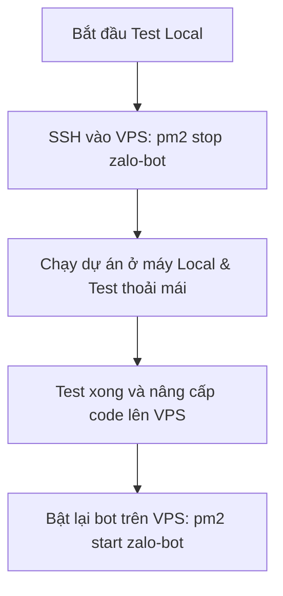

# Hướng Dẫn Bảo Trì, Nâng Cấp & Quy Trình Phát Triển Zalo Chatbot

Tài liệu này hướng dẫn chi tiết cách cập nhật code từ máy cá nhân lên VPS và quy trình chạy thử nghiệm (test) ở môi trường local mà không gây xung đột với bot đang chạy thực tế trên server.

---

## I. Quy Trình Nâng Cấp Code Lên VPS

Khi bạn đã hoàn thành việc lập trình và kiểm thử tính năng mới ở máy local, hãy làm theo các bước sau để cập nhật lên VPS:

### 1. Cập nhật Backend (Java Spring Boot)

*   **Bước 1: Đóng gói code ở máy local**
    Mở Terminal/CMD ở máy tính cá nhân tại thư mục `spring-boot-backend` và chạy lệnh:
    ```bash
    mvn clean package -DskipTests
    ```
    Lệnh này sẽ tạo ra file `target/bot-zalo-backend-0.0.1-SNAPSHOT.jar`.

*   **Bước 2: Upload file lên VPS**
    Mở CMD ở máy cá nhân và chạy lệnh upload đè lên file cũ:
    ```cmd
    scp "D:\bot_zalo\spring-boot-backend\target\bot-zalo-backend-0.0.1-SNAPSHOT.jar" root@221.132.21.35:/root/app/
    ```

*   **Bước 3: Khởi động lại dịch vụ Backend trên VPS**
    SSH vào VPS và chạy lệnh:
    ```bash
    sudo systemctl restart zalo-backend
    ```

---

### 2. Cập nhật Bot Client (Node.js)

*   **Bước 1: Upload file code có thay đổi lên VPS**
    Ví dụ nếu bạn chỉ chỉnh sửa file `index.js`, hãy chạy lệnh upload ở máy local:
    ```cmd
    scp "D:\bot_zalo\zalo-bot\index.js" root@221.132.21.35:/root/app/zalo-bot/
    ```

*   **Bước 2: Khởi động lại dịch vụ Bot trên VPS**
    SSH vào VPS và chạy lệnh:
    ```bash
    pm2 restart zalo-bot
    ```

> [!NOTE]
> Nếu bạn có cài thêm thư viện npm mới ở file `package.json`, sau khi upload file `package.json` lên VPS, bạn phải SSH vào VPS, truy cập thư mục `/root/app/zalo-bot` và chạy lệnh `npm install` trước khi restart bot.

---

## II. Quy Trình Tránh Xung Đột Khi Test Ở Local

Khi cả Bot local và Bot VPS sử dụng chung một tài khoản Zalo, cả hai sẽ cùng nhận được tin nhắn và phản hồi cùng lúc, gây ra hiện tượng **trả lời trùng lặp trong nhóm**.

Có 2 phương pháp xử lý hiệu quả:

### Phương án A: Tạm dừng Bot trên VPS (Khuyên dùng - Đơn giản nhất)

Áp dụng khi bạn chỉ muốn dùng 1 tài khoản Zalo duy nhất và chỉ test trong thời gian ngắn:



1.  **Trước khi test ở local:** SSH vào VPS và tạm tắt bot server:
    ```bash
    pm2 stop zalo-bot
    ```
2.  **Chạy test dưới local:** Bật backend và bot ở máy cá nhân lên để test bình thường.
3.  **Sau khi test xong:** Đóng gói, upload code mới lên VPS (theo phần I) rồi bật lại bot trên VPS:
    ```bash
    pm2 start zalo-bot
    ```

---

### Phương án B: Sử dụng tài khoản Zalo Test riêng biệt

Áp dụng khi bạn muốn test tính năng liên tục mà không muốn ảnh hưởng đến hoạt động 24/7 của bot chính trên VPS:

1.  **Nick Bot Chính (Chạy trên VPS):** Sử dụng tài khoản Zalo A (được lưu phiên đăng nhập trong file `credentials.json` trên VPS).
2.  **Nick Bot Test (Chạy dưới Local):** 
    *   Xóa file `credentials.json` ở thư mục `zalo-bot` dưới máy local của bạn.
    *   Chạy khởi động bot local, hệ thống sẽ sinh mã QR mới. Bạn lấy một tài khoản Zalo phụ khác (Tài khoản B) để quét đăng nhập.
    *   Tạo một nhóm chat riêng để test và mời tài khoản B này vào. 
    *   *Kết quả:* Khi test ở local, chỉ tài khoản B trả lời trong nhóm test, còn tài khoản A vẫn chạy độc lập trên VPS phục vụ các nhóm chính thức.

---

## III. Bảng Tra Cứu Lệnh Nhanh Trên VPS (Cheatsheet)

Dưới đây là các lệnh thông dụng bạn cần nhớ khi kết nối vào VPS để quản lý ứng dụng:

| Tên Dịch Vụ | Tác Vụ | Lệnh Thực Thi Trên VPS |
| :--- | :--- | :--- |
| **Backend (Java)** | Kiểm tra trạng thái | `sudo systemctl status zalo-backend` |
| | Khởi động lại | `sudo systemctl restart zalo-backend` |
| | Dừng dịch vụ | `sudo systemctl stop zalo-backend` |
| | Xem log chạy trực tiếp | `sudo journalctl -u zalo-backend -f -n 100` |
| **Bot (Node.js)** | Xem danh sách bot chạy | `pm2 status` |
| | Kiểm tra log chạy trực tiếp | `pm2 logs zalo-bot` |
| | Khởi động lại | `pm2 restart zalo-bot` |
| | Tạm dừng bot | `pm2 stop zalo-bot` |
| | Lưu cấu hình tự khởi động | `pm2 save` |
